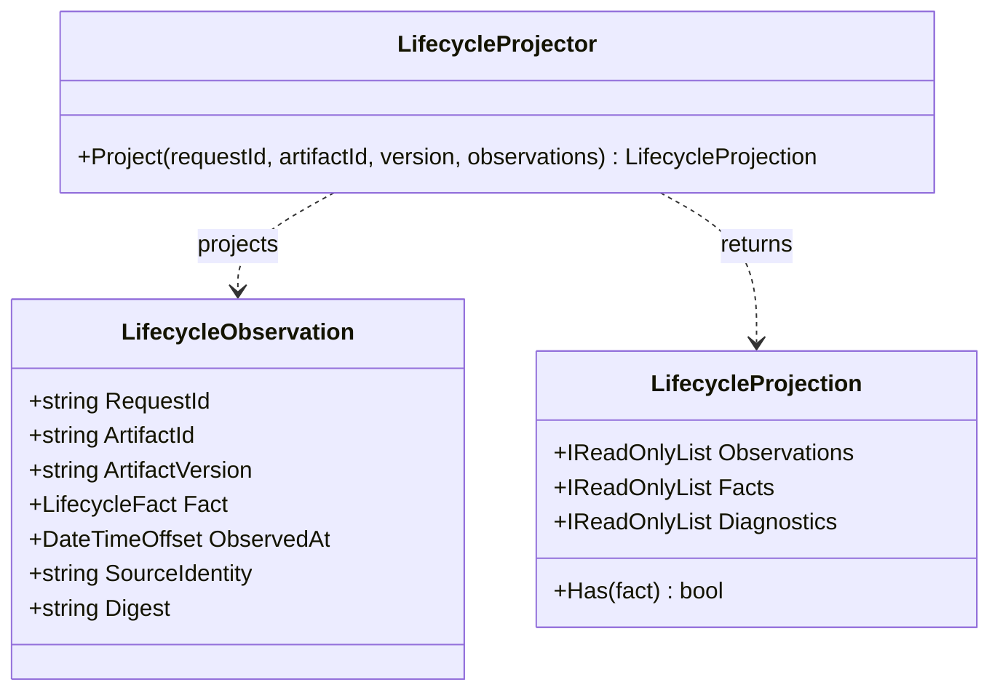

# LifecycleProjector UML and Use Case

**Owner moniker:** The Singularity Workshop  
**Purpose:** project independently observed lifecycle facts without inventing missing transitions.

## Use case

1. Coordinator gathers observations from provider, client, and CI.
2. CogE filters out mismatched request/artifact identities and emits diagnostics.
3. The projection keeps each fact distinct and sorts by observation time.
4. Missing retrieval, validation, or acknowledgement prerequisites are reported.
5. A maintainer or consumer makes the acceptance decision; projection does not decide for them.
