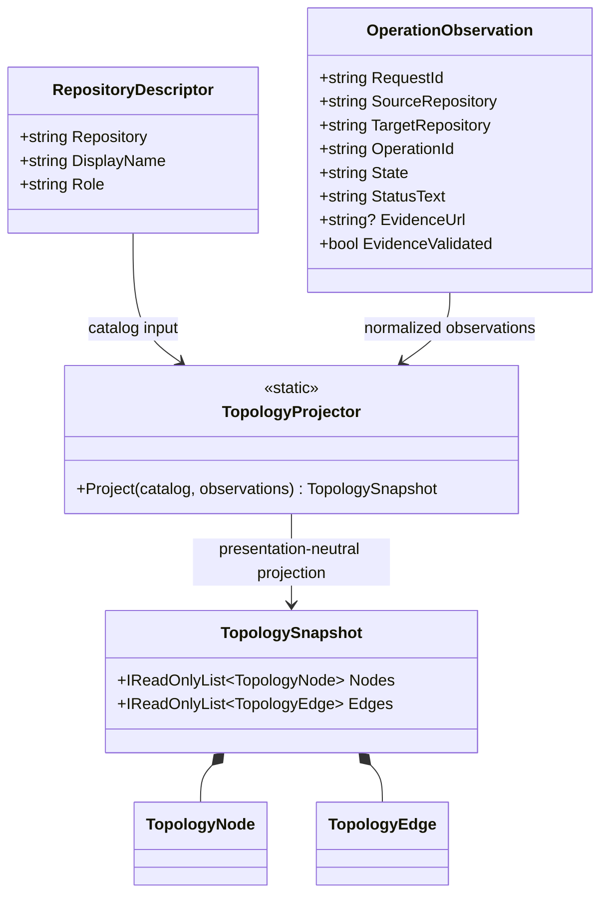

# TopologyProjector — UML Class Card and Use Case

**User moniker:** CogE GUI-Ready Topology Projection

## Use case: project an evidence-aware topology

1. The trusted host supplies catalog descriptors and operation observations.
2. `TopologyProjector` rejects invalid or duplicate catalog identities.
3. Observations referring to unknown repositories are omitted; unvalidated claims are downgraded to unknown or stale.
4. Only evidence marked validated and carrying an HTTPS URL is exposed as a link.
5. A renderer consumes the resulting nodes and directed edges without interpreting them as authorization.

## Boundary

CogE performs no I/O, fetches no CI state, and cannot establish whether an operation actually succeeded. Evidence validation belongs to the trusted coordinator.
