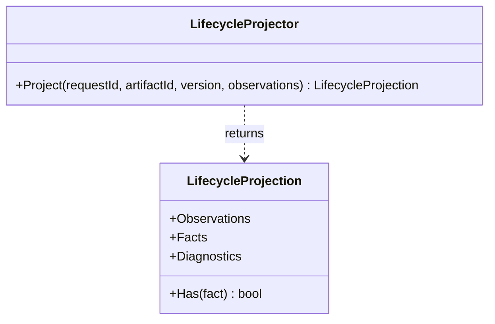

# LifecycleProjector

**Owner moniker:** The Singularity Workshop  
**Purpose:** project timestamped lifecycle facts, sort observations, and report identity mismatches and contradictory evidence.

## Responsibility

Project timestamped lifecycle facts, sort observations, and report identity mismatches and contradictory evidence. The class provides a bounded, dependency-free control-plane primitive. It does not perform remote execution, grant implicit permission, or replace authoritative provider evidence.

## UML class card

For the focused class diagram and use case, see [LifecycleProjector UML](../../docs/UML/LifecycleProjectorUML.md).
